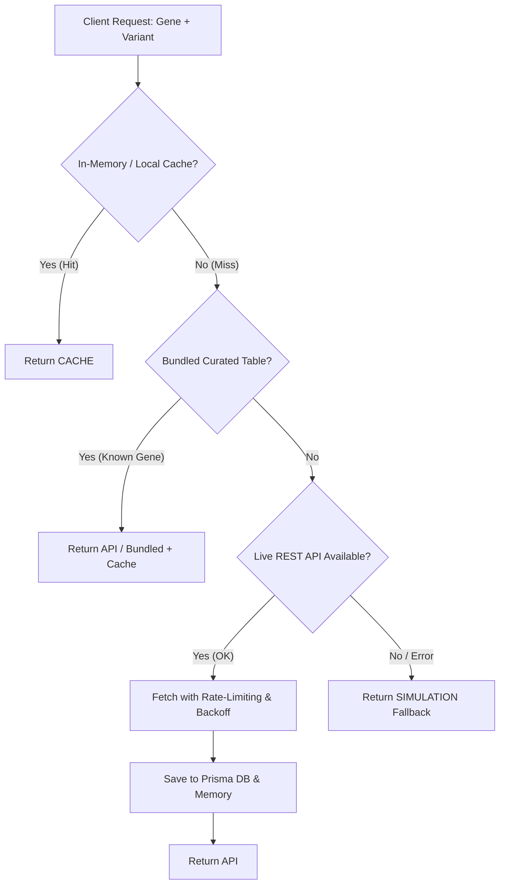

# Data Source Integration Pattern

A standardized, repeatable pattern for integrating genomic scores, machine learning predictions, and structural bioinformatics models into MutationMechanic.

---

## 1. Core Architecture Pattern

Every score or prediction source in MutationMechanic follows a 4-tier lifecycle:



### The 4 Tiers:
1. **Tier 1 — Cache (`CACHE`)**: Fast in-memory / localStorage / Prisma DB retrieval (<5ms).
2. **Tier 2 — Bundled Reference (`API` / Curated)**: High-confidence precomputed dataset for benchmark and `UNIPROT_MAP` clinical genes.
3. **Tier 3 — Live REST Endpoint (`API`)**: Public/hosted API (e.g., MyVariant.info, AlphaFold DB, Ensembl) with exponential backoff and rate-limiting.
4. **Tier 4 — Procedural Fallback (`SIMULATION`)**: Explicitly marked simulated/procedural estimation when networks or keys are unavailable. **Never fake a real API response.**

---

## 2. Standard Integration Checklist

When integrating a new score (e.g. AlphaMissense, SpliceAI, CADD, ESMFold, PhyloP):

- [ ] **1. Licensing & Attribution Review**:
  - Identify the upstream data license (e.g., CC BY 4.0, Apache 2.0, Open Database License).
  - Note mandatory citations or commercial restrictions in product documentation and tooltips.
- [ ] **2. Data Hosting Strategy**:
  - Determine whether full-genome files (>3 GB) can be avoided by using precomputed REST queries (e.g. MyVariant.info) or curated gene-level tables.
- [ ] **3. Backend Client & Rate-Limiting**:
  - Implement request throttling (e.g., maximum 5–10 req/sec) and exponential backoff (1s -> 2s -> 4s) with a strict timeout (10–15s).
- [ ] **4. Prisma Persistence**:
  - Upsert results into PostgreSQL / Prisma model (`Prediction`, `SplicingAnalysis`, `Variant.annotations`).
- [ ] **5. Source Badge Tagging**:
  - Return `{ source: 'API' | 'CACHE' | 'SIMULATION', ...data }` payload contract.
- [ ] **6. UI Presentation**:
  - Render an explicit source badge (Emerald for `API`, Cyan for `CACHE`, Amber/Gray for `SIMULATION`).
  - Add metric tooltips explaining the clinical/biological significance of the score.

---

## 3. Standard Response Contract

All scoring endpoints must conform to this JSON envelope:

```typescript
export interface ScoringResponse<T> {
  gene: string;
  variant: string;
  source: 'API' | 'CACHE' | 'SIMULATION';
  data: T;
  attribution: {
    sourceName: string;
    version?: string;
    license: string;
    citation?: string;
  };
  cachedAt?: number;
}
```

---

## 4. Current Implementations

| Source | Upstream Service / File | License / Attribution | Typical Latency |
| :--- | :--- | :--- | :--- |
| **Gemini 3 Flash** | Google GenAI SDK | Google Cloud Terms | ~800–1800 ms |
| **AlphaFold 3 / DB** | EBI AlphaFold API / ESMFold | CC BY 4.0 (Varadi et al., 2022) | ~300–1200 ms |
| **AlphaMissense** | DeepMind Precomputed / MyVariant.info | CC BY 4.0 (Cheng et al., *Science* 2023) | ~50–150 ms |
| **SpliceAI** | Precomputed Illumina / MyVariant.info | BioThings (Xin et al., 2016) | ~60–200 ms |

---

## 5. Four-State Badge System & Trust Guarantees

MutationMechanic strictly rejects opaque fallbacks. The UI communicates the exact pedigree and compute status of every model output using a four-state badge system:

| State | Badge Color & Icon | What It Means | Trust & Compute Guarantee |
| :--- | :--- | :--- | :--- |
| **`LIVE API`** | 🟢 **Emerald Pulse** (`bg-emerald-500/10`) | Real-time live inference returned directly from an upstream API. | Live generative reasoning or precomputed REST lookup verified against upstream deep learning weights. |
| **`LIVE (CACHED)`** | 🔵 **Cyan Glow** (`bg-cyan-500/10`) | Authentic API result served from local memory / PostgreSQL cache. | Bit-for-bit identical to a live API response; instant $<5\text{ms}$ retrieval with zero quota consumption. |
| **`OFFLINE DEMO (FORCED)`** | 🟣 **Purple Badge** (`bg-purple-500/10`) | User intentionally enabled "Forced Offline / Demo Mode" in Settings. | Synthetic benchmark dataset active for offline conferences/demos; no external network traffic or quota usage. |
| **`SIMULATION (FALLBACK)`** | 🟡 **Amber Border** (`bg-amber-500/10`) | Upstream API was unavailable (unconfigured key, network error, rate limit). | Algorithmic procedural estimation clearly marked as non-live; never papered over or disguised as real data. |

### Guarantees:
1. **No Silent Fallbacks**: If an API call fails, the system immediately switches the badge from Emerald to Amber `SIMULATION (FALLBACK)` so researchers never mistake synthetic estimates for experimental predictions.
2. **Persistent Intent**: Forced Offline Mode is stored in `localStorage` and prominently surfaced on boot with a high-contrast purple badge until manually toggled off.
3. **Research-Only Context**: Every badge is paired with a neighboring research-use disclaimer and upstream license citation (e.g. DeepMind CC BY 4.0).
