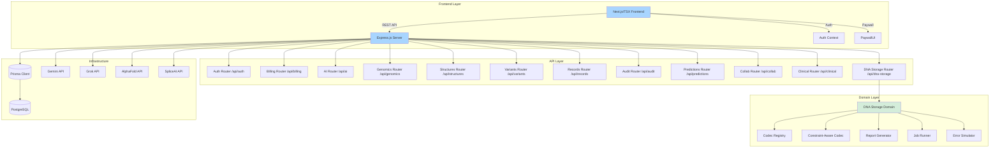
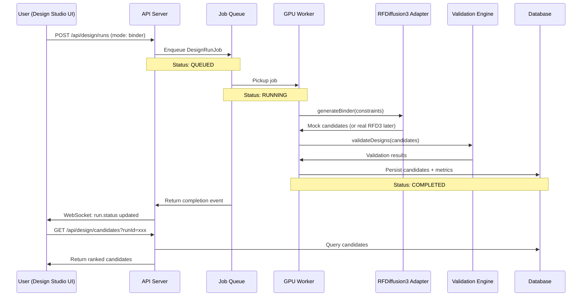
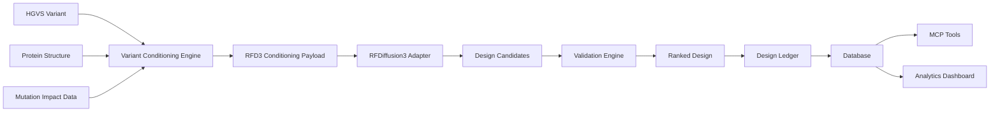
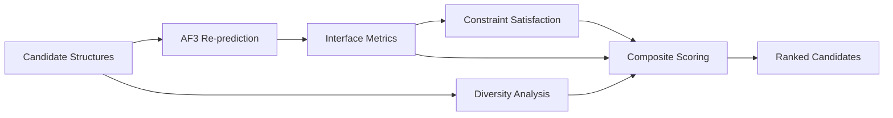
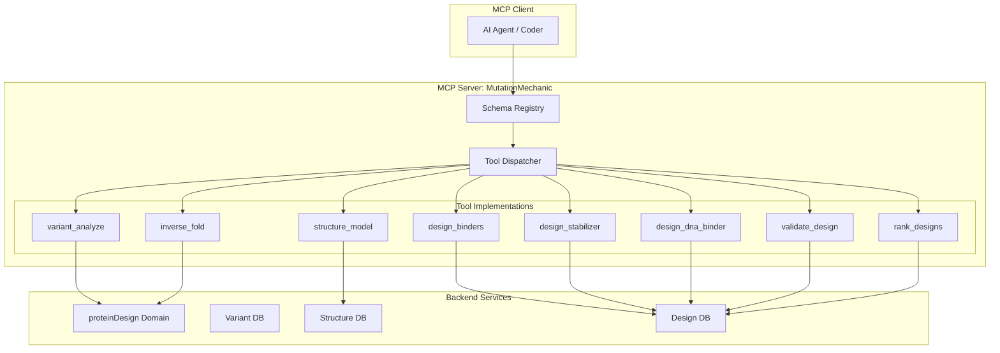
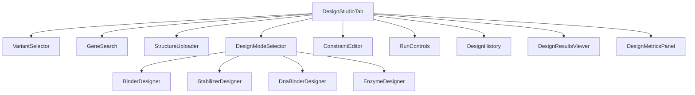
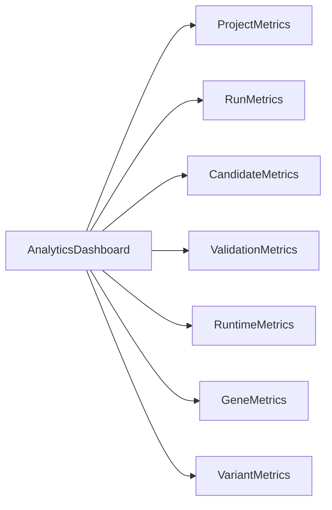

# RFdiffusion3 System Architecture
**Repository**: MutationMechanic  
**Architecture Date**: 2026-09-21

## 1. Current Architecture Diagram



## 2. Future Architecture Diagram

```mermaid
graph TD
    subgraph "Client Layer"
        A[Design Studio UI] -->|API| B[Express.js Server]
        A -->|WebSocket| WS[Job Status Updates]
        F2[Variant Selector] --> A
        F3[Gene Search] --> A
        F4[Structure Upload] --> A
        F5[PDB Viewer] --> A
    end

    subgraph "API Orchestration Layer"
        B -->|Design API| D1[/api/design/projects]
        B -->|Design API| D2[/api/design/runs]
        B -->|Design API| D3[/api/design/candidates]
        B -->|Design API| D4[/api/design/validate]
        B -->|Existing| E[Auth Router]
        B -->|Existing| F[Billing Router]
        B -->|Existing| G[Variants Router]
        B -->|Existing| H[Clinical Router]
        B -->|Existing| I[DNA Storage Router]
        B -->|MCP Tools| MCP[MCP Server Layer]
    end

    subgraph "Domain Layer"
        subgraph "proteinDesign Domain"
            D1 --> DD1[DesignProject Service]
            D2 --> DD2[DesignRun Service]
            D3 --> DD3[DesignCandidate Service]
            D4 --> DD4[Validation Service]
            DD2 --> DD5[Variant Conditioning Engine]
            DD2 --> DD6[Job Queue Service]
            DD6 --> DD7[RFDiffusion3 Adapter]
            DD7 --> DD8[Mock RFD3 Inference]
            DD4 --> DD9[Design Validation Engine]
            DD2 --> DD10[Design Ledger Service]
            D3 --> DD11[Design Ranking Service]
        end

        subgraph "dnaStorage Domain (Existing)"
            I --> DS[DNA Storage Domain]
        end
    end

    subgraph "Job Queue"
        DD6 --> Q1[(Redis Queue)]
        Q1 --> W1[GPU Worker Pool]
        Q1 --> W2[CPU Worker Pool]
        W1 -->|GPU Jobs| DD7
        W2 -->|Validation| DD9
    end

    subgraph "Infrastructure"
        B --> PR[(Prisma Client)]
        PR --> PG[(PostgreSQL)]
        PR --> PG2[(PostgreSQL - Design Tables)]
        DD7 --> GPU1[(GPU Cluster)]
        DD8 -->|Mock| MOCK1[(Mock RFD3 Responses)]
    end

    subgraph "MCP Tools"
        MCP --> M1[variant_analyze]
        MCP --> M2[structure_model]
        MCP --> M3[design_binders]
        MCP --> M4[design_stabilizer]
        MCP --> M5[design_dna_binder]
        MCP --> M6[inverse_fold]
        MCP --> M7[validate_design]
        MCP --> M8[rank_designs]
    end

    style A fill:#a8d5ff
    style B fill:#a8d5ff
    style DD1 fill:#d4edda
    style DD2 fill:#d4edda
    subgraph style: proteinDesign color:#c3e6cb
```

## 3. Service Boundaries

### 3.1 Existing Services (Preserved)
| Service | Boundary | Responsibility |
|---------|----------|----------------|
| Auth Service | `/api/auth` | User authentication, JWT tokens |
| Billing Service | `/api/billing` | Subscription management, metering |
| Clinical Service | `/api/clinical` | Clinical variant interpretation |
| Variants Service | `/api/variants` | Variant lookup, annotation |
| Structures Service | `/api/structures` | Protein structure retrieval |
| Predictions Service | `/api/predictions` | ML predictions (AlphaMissense, etc.) |
| DNA Storage Service | `/api/dna-storage` | In-silico DNA data storage |

### 3.2 New Protein Design Services
| Service | Boundary | Responsibility |
|---------|----------|----------------|
| Design Project Service | `/api/design/projects` | CRUD for design projects |
| Design Run Service | `/api/design/runs` | Create/tracking design runs |
| Design Candidate Service | `/api/design/candidates` | Retrieve/design candidate structures |
| Validation Service | `/api/design/validate` | Validate candidate structures |
| Variant Conditioning Engine | `domain/proteinDesign/conditioning/` | Translate variants → RFD3 constraints |
| Job Queue Service | `domain/proteinDesign/jobs/` | Async job management |
| RFDiffusion3 Adapter | `domain/proteinDesign/adapters/` | RFD3 inference wrapper |
| Design Validation Engine | `domain/proteinDesign/validation/` | Structure/sequence validation |
| Design Ranking Service | `domain/proteinDesign/ranking/` | Composite score ranking |
| Design Ledger Service | `domain/proteinDesign/provenance/` | Immutable audit trail |

## 4. Job Orchestration Flow



### 4.1 Job States Lifecycle
```
QUEUED → RUNNING → VALIDATING → COMPLETED
               ↘    ↗          ↘
                ↘ FAILED        FAILED
```

**Phase 1**: All jobs return mock payloads immediately
**Phase 5+**: Real RFD3 execution via GPU workers

## 5. Data Flow

### 5.1 Variant-to-Design Data Flow


### 5.2 Data Flow Steps
1. **Input**: HGVS variant notation + protein structure (PDB/mmCIF) + mutation impact data
2. **Conditioning**: VariantConditioningEngine translates to RFD3 constraints:
   - Hotspot residues identification
   - Burial depth requirements
   - Hydrogen bond constraints
   - Target interface regions
3. **Generation**: RFDiffusion3Adapter produces candidate structures
4. **Sequence Design**: ProteinMPNN/LigandMPNN (future)
5. **Validation**: DesignValidationEngine checks:
   - Structural validation (AF3 re-prediction)
   - Interface metrics (pTM, ipTM, buried surface area)
   - Geometry compliance
   - Constraint satisfaction
   - Design diversity
   - Candidate ranking
6. **Ledger**: Immutable audit trail (model version, weights hash, seed, constraints)
7. **Output**: MCP tools expose each stage

## 6. Database Model Design

### 6.1 Prisma Schema Extensions

```mermaid
erDiagram
    DesignProject ||--o{ DesignRun : contains
    DesignRun ||--o{ DesignCandidate : generates
    DesignRun ||--o{ DesignConstraint : defines
    DesignRun }|--o{ DesignLedger : "audit trail"
    DesignCandidate ||--o{ ValidationResult : validates
    ValidationResult ||--o{ DesignLedger : "records"

    DesignProject {
        string id PK
        string name
        string description
        string userId FK
        enum status
        datetime createdAt
        datetime updatedAt
    }

    DesignRun {
        string id PK
        string projectId FK
        enum mode
        DesignStatus status
        json parameters
        json constraints
        string? gpuId
        datetime startedAt
        datetime completedAt
        datetime createdAt
        datetime updatedAt
    }

    DesignCandidate {
        string id PK
        string runId FK
        string structure
        string sequence
        float affinityScore
        int rankedPosition
        json metrics
        datetime createdAt
    }

    DesignConstraint {
        string id PK
        string runId FK
        string type
        json spec
        datetime createdAt
    }

    ValidationResult {
        string id PK
        string candidateId FK
        float pTM
        float ipTM
        float interfaceArea
        float constraintScore
        float diversityScore
        float overallScore
        json details
        datetime createdAt
    }

    DesignLedger {
        string id PK
        string candidateId FK
        string modelVersion
        string weightsHash
        string seed
        json inputConstraints
        string userId
        datetime validatedAt
        datetime createdAt
    }
```

## 7. Validation Pipeline



### 7.1 Validation Stages
| Stage | Tools | Metrics |
|-------|-------|---------|
| Structural Validation | AlphaFold 3 | pTM, ipTM, pLDDT |
| Interface Metrics | Rosetta InterfaceAnalyzer | Buried surface area, H-bond network |
| Constraint Satisfaction | Custom validator | % constraints met |
| Diversity Analysis | Clustering | Sequence diversity, structural diversity |
| Ranking | Composite scorer | Overall score, confidence intervals |

## 8. MCP Topology

### 8.1 MCP Server Architecture


### 8.2 MCP Tools (Phase 9)
| Tool | Input Schema | Output Schema | Backend Service |
|------|-------------|---------------|-----------------|
| `variant_analyze` | {hgvs: string, gene?: string, annotations?: object} | {impact: object, structureData?: string, constraints: Rfd3Constraints} | Variant Conditioning Engine |
| `structure_model` | {sequence: string, mutations?: string[]} | {pdb: string, afScore: number, microenvironment: object} | AlphaFold Adapter |
| `design_binders` | {targetStructure: string, constraints: object, mode: string} | {jobId: string, status: enum, candidates?: array} | RFDiffusion3 Adapter |
| `design_stabilizer` | {targetStructure: string, mutationData: object} | {jobId: string, candidates?: array} | RFDiffusion3 Adapter |
| `design_dna_binder` | {targetSequence: string, constraints: object} | {jobId: string, candidates?: array} | RFDiffusion3 Adapter |
| `inverse_fold` | {targetStructure: string, sequenceConstraints?: object} | {jobId: string, sequences?: array} | ProteinMPNN Adapter |
| `validate_design` | {candidateId: string, structure: string} | {validationResult: ValidationResult} | Design Validation Engine |
| `rank_designs` | {candidateIds: string[], weights: object} | {rankedCandidates: RankedCandidate[]} | Design Ranking Service |

## 9. Frontend Architecture

### 9.1 Design Studio Tab


### 9.2 React Component Hierarchy
| Component | Parent | State Managed |
|-----------|--------|---------------|
| `DesignStudioTab` | App.tsx | activeMode, project, selectedVariant |
| `VariantSelector` | DesignStudioTab | selectedVariant, variantList |
| `GeneSearch` | DesignStudioTab | searchQuery, geneResults |
| `StructureUploader` | DesignStudioTab | uploadedStructure, pdbData |
| `DesignModeSelector` | DesignStudioTab | activeMode (binder/stabilizer/dna/enzyme) |
| `ConstraintEditor` | DesignStudioTab | constraints, hotspotResidues |
| `RunControls` | DesignStudioTab | parameters, runStatus |
| `BinderDesigner` | DesignModeSelector | binderConstraints |
| `StabilizerDesigner` | DesignModeSelector | stabilizerConstraints |
| `DnaBinderDesigner` | DesignModeSelector | dnaBindingConstraints |
| `EnzymeDesigner` | DesignModeSelector | enzymeConstraints, catalyticSite |
| `DesignHistory` | DesignStudioTab | historyList, filter |
| `DesignResultsViewer` | DesignStudioTab | candidates, selection |
| `DesignMetricsPanel` | DesignStudioTab | validationMetrics, scores |

## 10. Analytics Dashboard

### 10.1 Metrics Tracked
| Metric | Source | Dashboard Element |
|--------|--------|-------------------|
| Projects created | DesignProject | Project cards |
| Runs completed | DesignRun | Run timeline |
| Candidates generated | DesignCandidate | Candidate gallery |
| Validation scores | ValidationResult | Score histogram |
| Run duration | DesignRun | Duration chart |
| Top genes targeted | DesignProject.gene | Gene ranking |
| Common variants | DesignProject.variant | Variant frequency |

### 10.2 Dashboard Components


## 11. Design Ledger (Audit Trail)

### 11.1 Immutability Strategy
- Each design execution writes a new ledger entry
- Entries include: model version, weights hash, seed, input constraints, user, timestamp
- No UPDATE/DELETE allowed on ledger records
- Soft delete pattern not applied to ledger

### 11.2 Reconciliation Requirements
- Every candidate must have a ledger entry
- Ledger entries must match the candidate's input constraints
- Periodic audit jobs verify consistency

## 12. Phase 1 Implementation Scope

### 12.1 Deliverables in Phase 1
- [x] Gap analysis document
- [x] System architecture document
- [ ] Prisma schema reconstructed with new models
- [ ] Prisma migrations for design tables
- [ ] Backend domain module (`proteinDesign/`) with interfaces
- [ ] Backend API routes (`/api/design/*`)
- [ ] Design Studio frontend tab with components
- [ ] Mock RFDiffusion3Adapter
- [ ] Mock job queue
- [ ] MCP tool schemas

### 12.2 Mock Strategy
- RFD3 inference returns mock candidates with realistic structure data
- Job queue simulates async execution with delays
- Validation engine returns mock scores based on candidate properties
- All mock responses are typed and documented as such